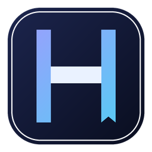
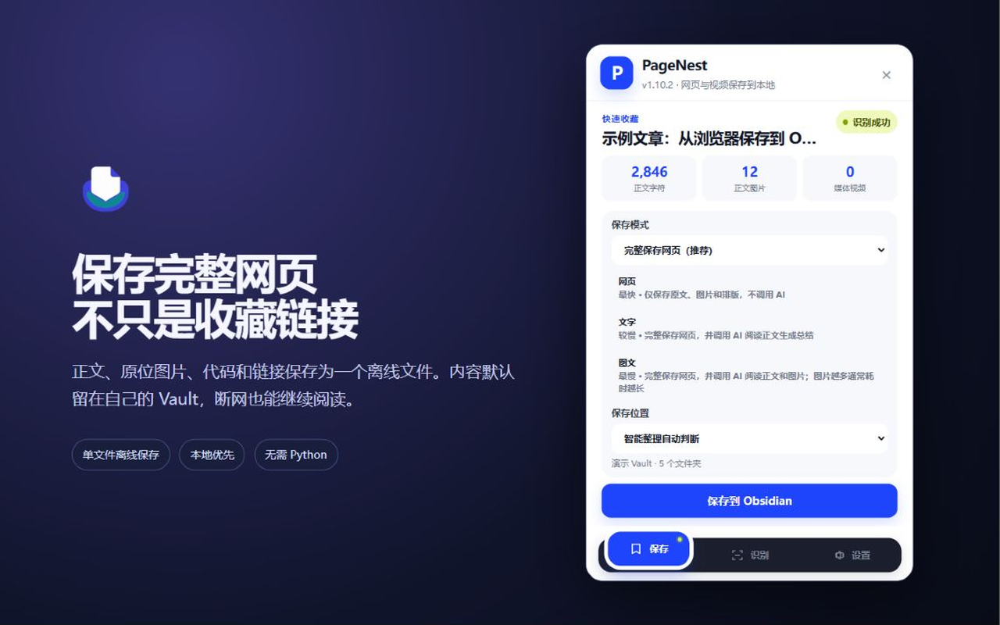
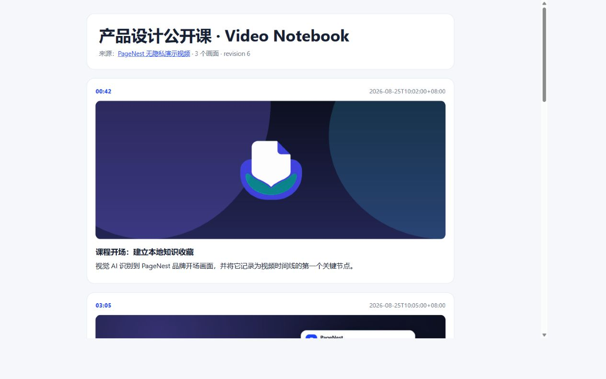
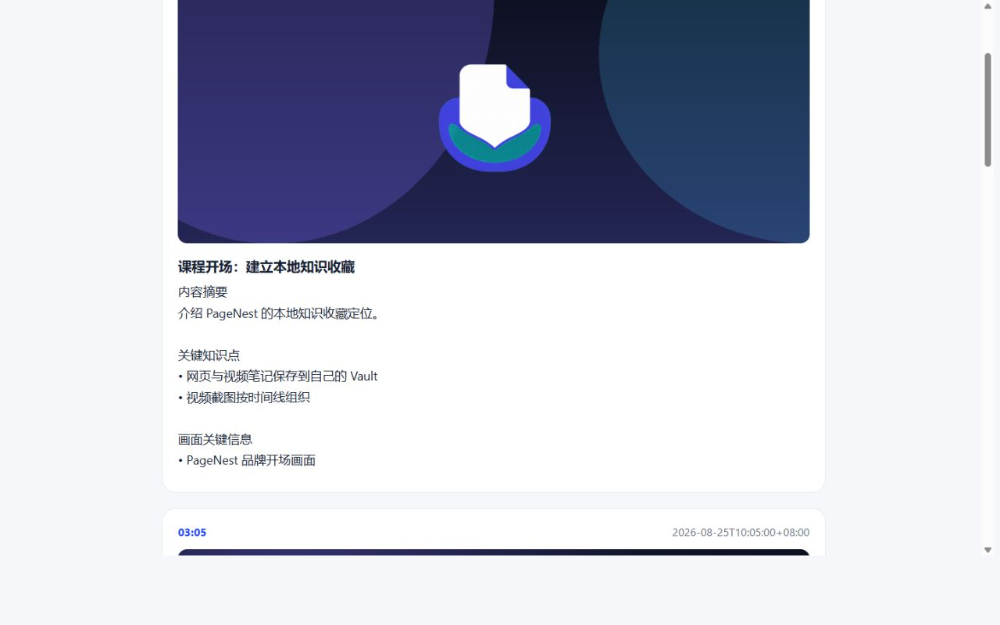
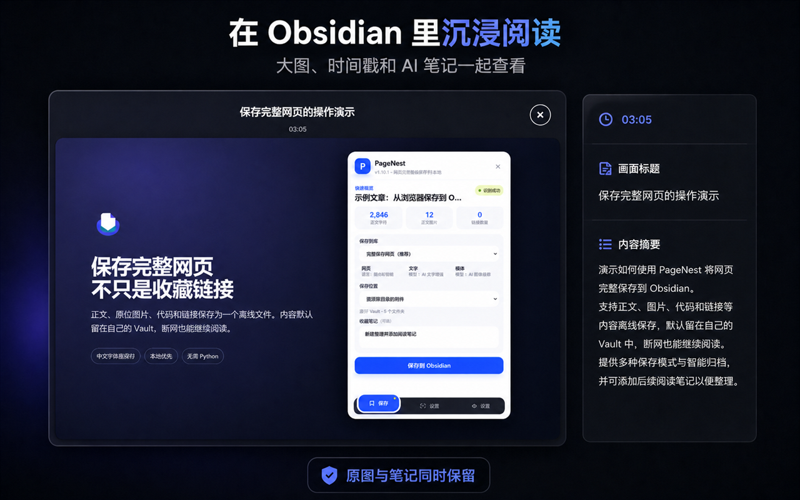
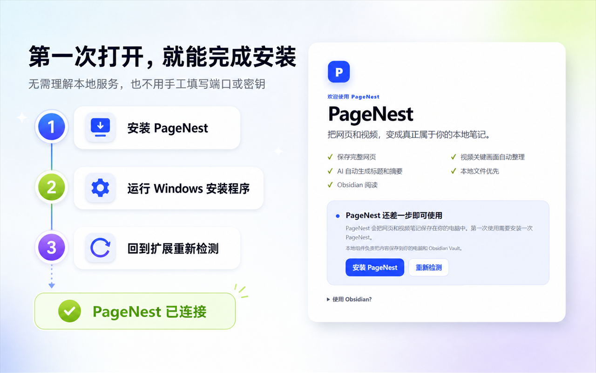

<h1 align="center">PageNest</h1>

<strong>把网页和视频保存成真正属于你的本地笔记。</strong>

收藏完整网页，而不是只留一个链接；观看视频时按下快捷键，把关键画面自动整理成可搜索、可放大的时间线笔记。

  
  
  
  
  

  <strong>简体中文</strong> ·
  <a href="README.en.md">English</a> ·
  <a href="https://github.com/WYuHuai/PageNest/releases/download/v1.10.0/PageNest-Setup-1.10.0.exe">下载安装器</a> ·
  <a href="docs/troubleshooting.md">故障排查</a>

PageNest 是面向 Windows、Microsoft Edge 和 Obsidian 的本地优先知识收藏器。网页会
保存为一个自包含的 `.pagenest` 文件；视频关键画面会进入同一个 Video Notebook，
按照视频时间自动排序。你可以选择自己的 OpenAI-compatible 视觉模型，让 AI 为每张
截图生成标题和摘要；即使 AI 失败，原始截图也不会丢失。

## 产品展示

以下截图来自真实 PageNest UI 与 Viewer，使用无隐私的演示内容。

<table>
  <tr>
    <td width="50%"> 保存完整网页，不只是收藏链接</td>
    <td width="50%"> 按一下快捷键，把视频关键画面整理成时间线</td>
  </tr>
  <tr>
    <td width="50%"> 视觉 AI 自动生成画面标题和内容摘要</td>
    <td width="50%"> 点击截图放大查看，图片和 AI 笔记同时保留</td>
  </tr>
  <tr>
    <td width="50%"> 本地优先：笔记存到自己的 Vault</td>
  </tr>
</table>

## 核心能力

- **收藏网页，而不是链接：** 保存正文结构、原位图片、GIF、代码、表格、链接和支持的媒体，生成一个可移动的离线文件。
- **Video Notebook：** 在 HTML5 视频页按 `Ctrl+Shift+Y`，直接保存当前解码画面，并按时间戳整理到同一本笔记。
- **可选视觉 AI：** 使用你自己配置的兼容接口生成截图标题和摘要；模型或网络失败不会影响截图保存。
- **Obsidian 阅读：** Viewer 在 Obsidian 内打开 `.pagenest`，支持搜索、图片 Lightbox、时间戳和 AI Summary。
- **本地优先：** 核心内容写入你选择的 Vault；没有 PageNest 云账号、广告或遥测。

## 2 分钟安装

PageNest 的完整功能需要 Microsoft Edge 扩展和 Windows Local Service。普通用户不需要理解或手工复制内部组件。

### 第一步：安装 Edge 扩展

从 Microsoft Edge Add-ons 安装 **PageNest 网页与视频笔记**。商店正式上架后，这也是扩展自动更新的唯一推荐入口。

> 如果商店页面仍在审核，请等待正式链接开放。`Load unpacked` 仅用于开发和故障恢复，不是普通安装方案。

### 第二步：运行 PageNest 安装器

从 [GitHub Releases](https://github.com/WYuHuai/PageNest/releases/tag/v1.10.0) 下载推荐安装包：

**[`PageNest-Setup-1.10.0.exe`](https://github.com/WYuHuai/PageNest/releases/download/v1.10.0/PageNest-Setup-1.10.0.exe)**

双击运行，选择一个已经存在的 Obsidian Vault。安装器会自动安装并启动 Local Service，
把 PageNest Viewer 放入所选 Vault，并配置商店扩展与本机服务的安全配对。无需安装
Python、Node.js，也无需手工填写 Service token。

完成后打开 PageNest 扩展；看到“PageNest 后台服务已连接”即可使用。

### 可选：在 Obsidian 中阅读

安装器已经把 Viewer 部署到所选 Vault。首次使用时只需重启 Obsidian，然后在
**设置 → 第三方插件**中启用 **PageNest Viewer**。这是 Obsidian 的插件启用安全机制，
安装器不会绕过它。

## 第一次使用

### 保存网页

打开网页 → 点击 PageNest → 选择位置 → **保存到 Obsidian**。

### 建立 Video Notebook

打开 HTML5 视频 → 按 `Ctrl+Shift+Y` → 当前画面立即保存 → 已配置视觉 AI 时，
标题和摘要随后写回。连续截图会进入同一本 Notebook，并按视频时间排序。

## Video Notebook

- 使用 Direct HTMLVideoElement Frame Capture，避免把播放器标题、悬浮进度条和其他页面 UI 截进画面。
- Standard 和 High 都保存 PNG；High 尽量保留源帧像素，但不会把低分辨率视频虚假放大。
- 每个 Entry 保留原截图、视频时间戳、分析状态、标题和摘要。
- 点击截图进入 Lightbox；大图、标题、时间戳和摘要同时可见。

受 DRM 保护的视频、跨域限制、网站播放器实现或低分辨率解码源可能阻止干净帧捕获。
PageNest 不绕过访问控制、付费墙或 DRM。

## Web Capture

PageNest 的目标不是把网页压成 Markdown，而是尽量保留网页本身的阅读价值。它支持
普通文章、本地 HTML，以及 GitHub README、小红书、飞书/飞书文档、微信公众号、
CSDN、B站和古月居等专用路径。网站结构随时可能变化，完整范围见
[支持矩阵](docs/supported-sites.md)。

三种保存模式：

| 模式 | 保存结果 | 需要 AI |
| --- | --- | --- |
| 完整保存网页 | 原文、图片、代码、链接和尽力保留的排版 | 否，推荐默认 |
| 完整保存 + AI 文字总结 | 完整网页与文字总结 | 是 |
| 完整保存 + AI 图文总结 | 完整网页与视觉总结 | 是，且模型需支持图片输入 |

## Obsidian Viewer

Viewer 直接渲染 `.pagenest`，不会执行收藏网页中的脚本。它支持全文搜索、代码复制、
图片轮播和 Video Notebook Lightbox。需要让其他工具读取资料库时，可运行
**PageNest Viewer：生成 AI 可读资料库**，生成一个可随时刷新的 `PageNest Library.md`。

## AI 配置（可选）

普通网页收藏和视频截图不要求 AI。需要自动标题或摘要时，在 **PageNest → 设置 →
高级设置**中填写 OpenAI-compatible Base URL、准确模型 ID 和自己的 API Key。
Video Notebook 必须使用同时支持图片输入、`image_url` data URL 和兼容 Chat
Completions 请求的模型/网关。保存设置会执行一次真实测试，可能产生少量费用。

API Key 保存在本机 Service 配置中；请勿把它提交到仓库、Issue 或日志。

## 隐私与本地优先

- Extension 仅在用户点击保存或按下视频截图快捷键时处理当前页面。
- Service 只监听 `127.0.0.1`，并使用随机 token 和允许的扩展 ID 保护连接。
- 原始保存模式不向 AI provider 发送内容；AI 模式只发送完成请求所需的正文或图片。
- PageNest 不出售数据，不含广告、遥测或分析 SDK。
- 用户应只保存自己有权留存的内容。

详见 [隐私政策](PRIVACY.md) 与 [安全边界](SECURITY.md)。

## 已知限制

- 安装器尚未进行 Authenticode 签名，Windows SmartScreen 可能显示“未知发布者”；不需要关闭 Microsoft Defender。
- Windows 11 已实机与自动化验证；Windows 10 尚未完整验证。
- 网站 DOM、播放器、签名资源或防盗链变化可能暂时影响专用采集。
- Viewer 首次使用仍需用户在 Obsidian 中明确启用插件。

## 开发者与架构

内部数据流与安全边界见 [架构文档](docs/architecture.md)、[版本兼容说明](docs/version-compatibility.md)
和 [v1.10.0 Release Notes](docs/release-notes-v1.10.0.md)。高级用户可以在 GitHub Release
Assets 中取得单独的 Extension、Service 和 Viewer 压缩包；普通用户应只下载 Windows 安装器。

## 手工安装（开发/恢复）

只有开发、离线诊断或商店版本暂不可用时，才使用安装器部署在
`%LOCALAPPDATA%\Programs\PageNest\Extension` 的备用副本，通过
`edge://extensions` 的开发人员模式加载。请勿把下载的源码目录当作已配对扩展加载。
Service 和 Viewer 的手工恢复步骤见[安装说明](docs/安装说明.html)。

## 从源码构建

源码构建、测试和贡献约定见 [CONTRIBUTING.md](CONTRIBUTING.md)。发布产物不会打包
`.env`、Vault 数据、浏览器配置、日志或测试目录。

## License

[MIT](LICENSE)
